# 上漲谷中控 圖文安裝與使用教學

這份教學從零開始：下載中控、安裝 Node.js 和竄改猴（Tampermonkey）、設定、打開遊戲，到每個分頁的功能怎麼用。

> - 截圖是在**模擬環境**拍的（角色名稱、數字都是假的），你的畫面內容會不一樣，但按鈕和位置相同。
> - 看不懂或卡住時，可以把這一頁的網址貼給 AI 助手（ChatGPT、Claude 等），請它一步一步帶你做。最下面有「給 AI 助手的說明」。
> - 每個功能更完整的細節在 [README](../README.md)；手機版另見 [手機版安裝教學](mobile.md)。

**目錄**
- [它是什麼、怎麼運作](#它是什麼怎麼運作)
- [第 1 步：安裝 Node.js](#第-1-步安裝-nodejs)
- [第 2 步：下載並啟動中控](#第-2-步下載並啟動中控)
- [第 3 步：Chrome 設定檔與竄改猴](#第-3-步chrome-設定檔與竄改猴)
- [第 4 步：打開遊戲、確認連線](#第-4-步打開遊戲確認連線)
- [第 5 步：認識面板](#第-5-步認識面板)
- [各功能教學](#各功能教學)：總覽與掛機、工作佇列、裝備、圖鑑、交易、背包、派工、組隊、副本、野王、市場、知識王、強化、公倉、手機版
- [自動更新](#自動更新)
- [常見問題](#常見問題)
- [給 AI 助手的說明](#給-ai-助手的說明)

---

## 它是什麼、怎麼運作

```
你的電腦
├─ 中控（黑色視窗，start.bat 啟動）── 面板 http://127.0.0.1:8787
│        ▲ 每個遊戲分頁定時回報角色資料、領取要做的工作
├─ Chrome 設定檔 1：遊戲分頁＋竄改猴腳本（帳號 1）
├─ Chrome 設定檔 2：遊戲分頁＋竄改猴腳本（帳號 2）
└─ …
```

- **中控**是在你電腦上跑的一個小程式，只接受你這台電腦自己連線，資料存在中控資料夾裡的 `data/`，**不會上傳到任何地方**。
- **竄改猴腳本**裝在每個 Chrome 設定檔裡，讓遊戲頁面把角色資料交給中控、並執行你在面板上按的操作。
- 不需要、也不會碰任何帳號密碼。交易、賣出、鎖定這類會動到遊戲資料的操作，都要在面板上按「確認執行」才會開始。

> 使用前請自行確認遊戲的使用規範。本專案與遊戲官方無關，使用造成的任何損失請自行負責。

### 你需要準備

| 項目 | 說明 |
|---|---|
| Windows 電腦 | 本教學以 Windows 為例 |
| Google Chrome | 每個遊戲帳號用一個 Chrome 設定檔（不同設定檔可以同時登入不同帳號） |
| 時間 | 第一次大約 20～30 分鐘；之後每多一個設定檔約 3 分鐘 |

---

## 第 1 步：安裝 Node.js

中控是用 Node.js 寫的，電腦要先裝 Node.js 才能執行。

1. 打開 <https://nodejs.org>，下載標示 **LTS** 的版本（Windows Installer `.msi`）。
2. 雙擊下載的檔案，一路按「Next／下一步」，最後按「Install」。中途的選項都保持預設即可。
3. 裝完**建議重新開機**一次（不然中控可能找不到 Node.js）。

**確認**：按開始鍵，輸入 `cmd` 按 Enter，在黑色視窗輸入：

```
node -v
```

出現像 `v22.x.x` 的版本號就代表裝好了。

---

## 第 2 步：下載並啟動中控

1. 打開中控的 GitHub 頁面：<https://github.com/Arashi9910/szg-hub-public>
2. 按綠色的 **Code** 按鈕 → **Download ZIP**。
3. 在下載的 ZIP 上按右鍵 →「解壓縮全部」，放到一個固定、好找的位置，例如 `D:\szg-hub`。
   - 不要直接在 ZIP 裡面執行；也盡量不要放在「下載」資料夾，以免之後被清掉。
4. 打開資料夾，雙擊 **`start.bat`**。
   - Windows 如果跳出「Windows 已保護您的電腦」，按「其他資訊」→「仍要執行」。

成功時，黑色視窗會顯示：

```
Using: node
上漲谷中控已啟動：http://127.0.0.1:8787
版本 0.xx.x。各設定檔安裝網址：http://127.0.0.1:8787/szg-hub.user.js

保持這個視窗開著；關掉視窗就會停止。
```

瀏覽器會自動打開面板 `http://127.0.0.1:8787`（這時候還沒有角色是正常的）。

> ⚠️ **玩的時候黑色視窗要一直開著**，關掉中控就停止了。可以縮小到工作列。

---

## 第 3 步：Chrome 設定檔與竄改猴

**每一個要連到中控的 Chrome 設定檔都要做一次這一步。**

### 3-1. 建立 Chrome 設定檔（每個帳號一個）
已經有的話跳過。Chrome 右上角的頭像 →「新增」→ 選「不登入繼續」（或登入任一個 Google 帳號）→ 取個好認的名字（例如「帳號 1」）。

### 3-2. 安裝竄改猴（Tampermonkey）
1. 在這個設定檔打開 [Chrome 線上應用程式商店的 Tampermonkey](https://chromewebstore.google.com/detail/dhdgffkkebhmkfjojejmpbldmpobfkfo)，按「**加到 Chrome**」→「新增擴充功能」。
2. 建議把它釘選到工具列：點網址列右邊的拼圖圖示 → Tampermonkey 旁的圖釘。

### 3-3. 允許竄改猴執行腳本（新版 Chrome 必做）
新版 Chrome 和竄改猴要多開一個權限，腳本才會執行：

- **Chrome 138 以上**：網址列輸入 `chrome://extensions` → 找到 Tampermonkey 按「**詳細資料**」→ 打開「**允許使用者指令碼**（Allow User Scripts）」開關。
  - 也可以在工具列的 Tampermonkey 圖示按右鍵 →「管理擴充功能」直接到這一頁。
- **Chrome 138 以前**：`chrome://extensions` 右上角打開「**開發人員模式**」。

> 不確定 Chrome 版本：網址列輸入 `chrome://settings/help` 查看。
> 官方說明（有圖）：[Tampermonkey FAQ Q209](https://www.tampermonkey.net/faq.php?q=Q209)

### 3-4. 安裝中控腳本
1. **確認中控的黑色視窗開著**。
2. 在這個設定檔的網址列打開：
   ```
   http://127.0.0.1:8787/szg-hub.user.js
   ```
3. 竄改猴會跳出安裝畫面，按「**安裝**」。

### 3-5. 讓腳本永遠拿到最新功能
1. 點 Tampermonkey 圖示 →「**控制台**」→ 上方「**設定**」分頁。
2. 最上面「**設定模式**」改成「**進階**」。
3. 往下找到「**外部**（Externals）」區塊的「**更新間隔**（Update Interval）」，改成「**總是**（Always）」。
4. 按頁面最下方的「儲存」（有的版本會自動儲存）。

這樣之後中控更新，遊戲頁面重新整理就會用到新功能，不用再動竄改猴。

---

## 第 4 步：打開遊戲、確認連線

在這個設定檔打開遊戲 <https://play.szg08.com/game/> 並登入。遊戲畫面**右下角**出現綠色的「**中控：已連線**」就完成了：


- 回到面板（`http://127.0.0.1:8787`），約 10 秒內就會看到這隻角色。
- **其他設定檔**照第 3、4 步各做一次。
- 右下角的「**＋ 開 某某 的分頁**」：同一個帳號的第二隻角色可以開自己的分頁，兩隻同時在線（詳見[總覽與掛機](#總覽與掛機)）。

| 右下角顯示 | 意思 |
|---|---|
| 中控：已連線（綠色） | 正常 |
| 連不到中控伺服器 | 中控的黑色視窗沒開，或被關掉了 |
| 完全沒有提示 | 腳本沒執行：檢查 3-3 的「允許使用者指令碼」、腳本有沒有啟用 |

---

## 第 5 步：認識面板

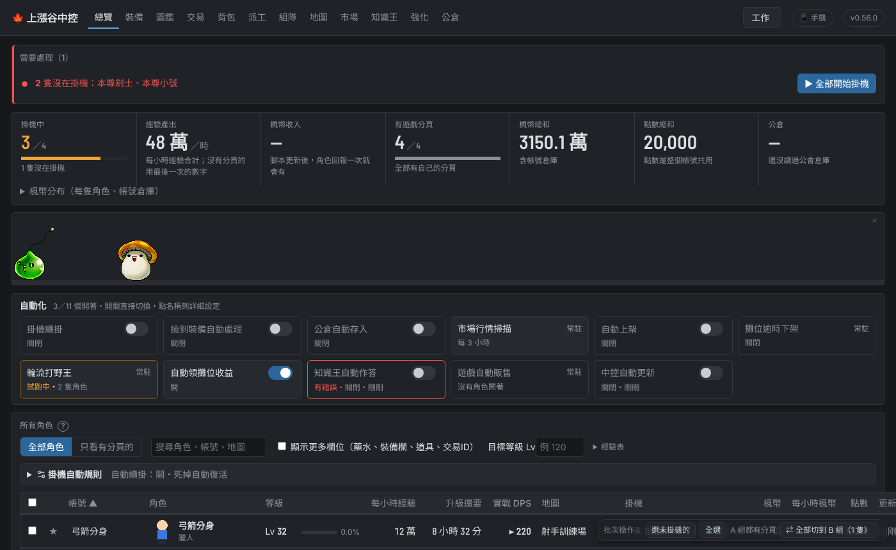

- **最上面一排分頁**：總覽、裝備、圖鑑、交易、背包、派工、組隊、野王、市場、知識王、強化、公倉。
- **右上角**：
  - **工作**：交易、賣出、存公倉等要你確認的工作都在這裡，有待確認的會亮起並顯示數量。
  - **📱 手機**：手機版配對（見[手機版](#手機版)）。
  - **版本**：點開看中控版本、腳本是否最新、自動更新設定。
- 各區塊標題旁的 **?** 是說明，滑鼠移過去就會顯示。

---

## 各功能教學

### 總覽與掛機


**看什麼**
- **需要處理**（最上方）：沒在掛機、快到期、離線掛機中、遊戲分頁沒開、有待確認或失敗的工作……旁邊都有一鍵處理按鈕。都沒問題時顯示「✓ 一切正常」。
- **數字列**：掛機中幾隻、每小時經驗合計、楓幣收入、有遊戲分頁的角色數、楓幣與點數總和、公倉容量。
- **自動化**：所有自動功能的開關一覽，點名稱跳到詳細設定。
- **角色表**：每隻角色的全身照、等級與經驗條、每小時經驗（下面小字「近3分」是中控即時量的）、升級還要多久、實戰 DPS、地圖、掛機剩餘時間、楓幣……點表頭可以排序。

**怎麼操作掛機**
1. 勾選角色（左邊的方框，可以多選；表頭的方框全選）。
2. 畫面底部出現操作列：**▶ 開始掛機／Ⅱ 暫停／↻ 重新開始**（重新計算 24 小時）／**⏏ 領取離線收益**／**⇄ 切換為目前角色**。
3. 「⚙ 掛機自動規則」可以設定：到期前自動續掛、掛滿 N 小時自動暫停、**死掉自動原地復活**（預設開）、離線掛機定時領取。

**小技巧**
- 填「目標等級 Lv」會多一欄「到 LvX」：練到那個等級要多久。
- 點 ★ 指定「本尊」，交易的「收集」會把東西集中到本尊。
- 同一個帳號的兩隻角色：遊戲右下角按「＋ 開 某某 的分頁」，兩隻都有自己的分頁時，資料都是即時的，各種操作也能同時進行。

### 工作佇列
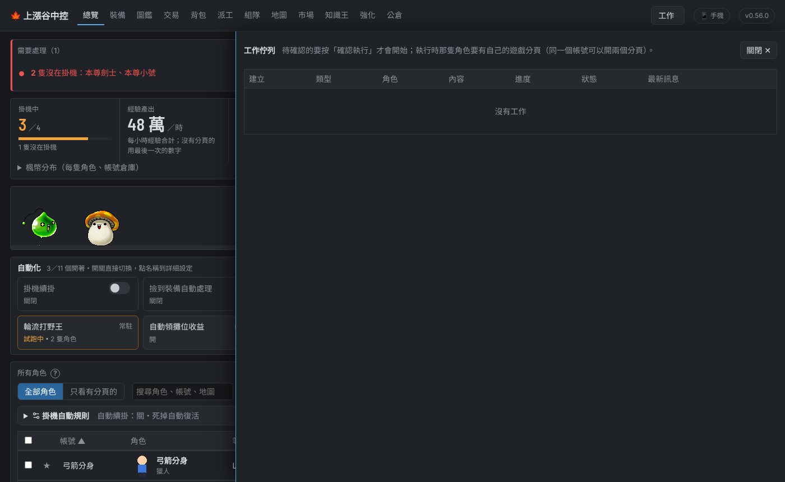

- 右上角「**工作**」打開。交易、背包賣出／鎖定、存入公倉、強化等都會先變成「**待確認**」的工作。
- 核對內容後按「**確認執行**」才會開始；可以取消、失敗的可以「重試」。
- 執行時，相關的角色要有自己的遊戲分頁開著。

### 裝備
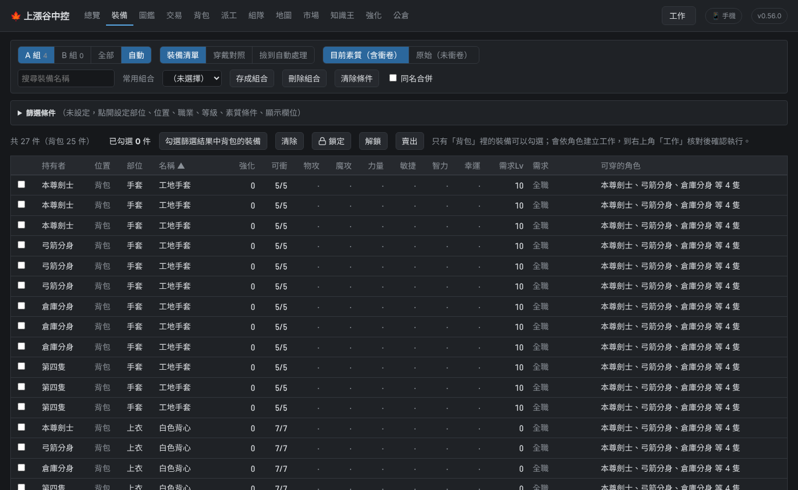

- 上方切換 **裝備清單／穿戴對照／撿到自動處理**，以及「目前素質（含衝卷）／原始（未衝卷）」。
- **裝備清單**：所有角色穿戴、背包、倉庫的裝備。用「篩選條件」依部位、職業、素質（`>` `>=` `<` `=` …，可「且／或」）找裝備；常用的篩選可以「存成組合」。
- 勾選背包裡的裝備 → **鎖定／解鎖／賣出**（會建立工作，到「工作」確認）。
- **撿到自動處理**：設規則，撿到不合條件的裝備自動賣掉。**建議先用「試跑」**看會賣哪些，重要裝備先鎖定。

### 圖鑑
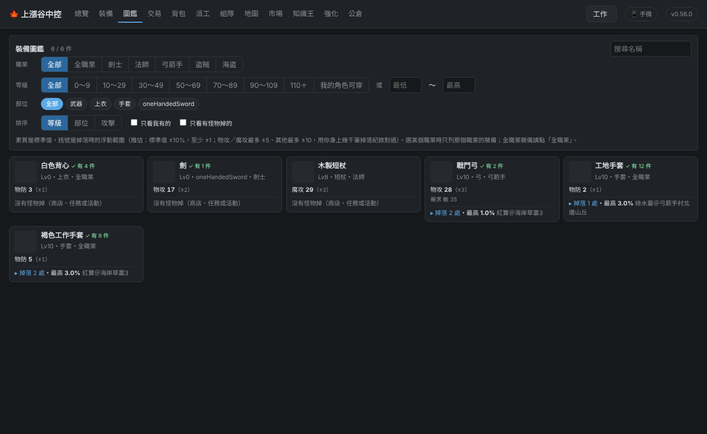

- 遊戲所有裝備（不含點裝）的**標準素質**和**掉落浮動範圍**（括號裡的 ±，推估值）。
- 依**職業**（選某職業只列那個職業；全職業裝備點「全職業」）、**等級**、**部位**、名稱篩選；可以「只看我有的」「我的角色可穿」「只看有怪物掉的」。
- 每件下面有「▸ 掉落 N 處」：點開看哪張地圖、哪隻怪會掉（依機率），按「**地圖**」跳到圖鑑的「地圖查詢」、按「**派工**」把那張圖放上派工看板，並把這件在那張圖設成留著（不會被自動賣掉）。

### 交易
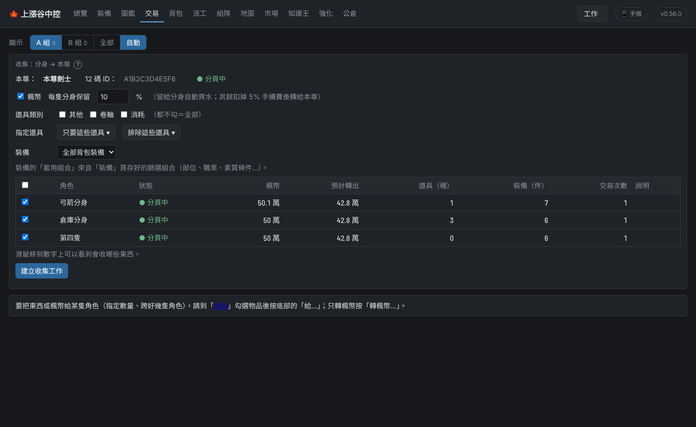

- **收集**：把分身背包裡可交易的道具、裝備、楓幣送到本尊（可設定每個分身保留多少 % 楓幣）。
- 要指定給某一隻角色，請到「背包」勾選後按「**給…**」。
- 中控會自動拆批（每次最多 20 格）、核對對方放的東西，不符就取消。**第一次建議先小量測試**（例如只給 1 個道具）。
- 同帳號的兩隻角色不能互相交易，請用倉庫。

### 背包
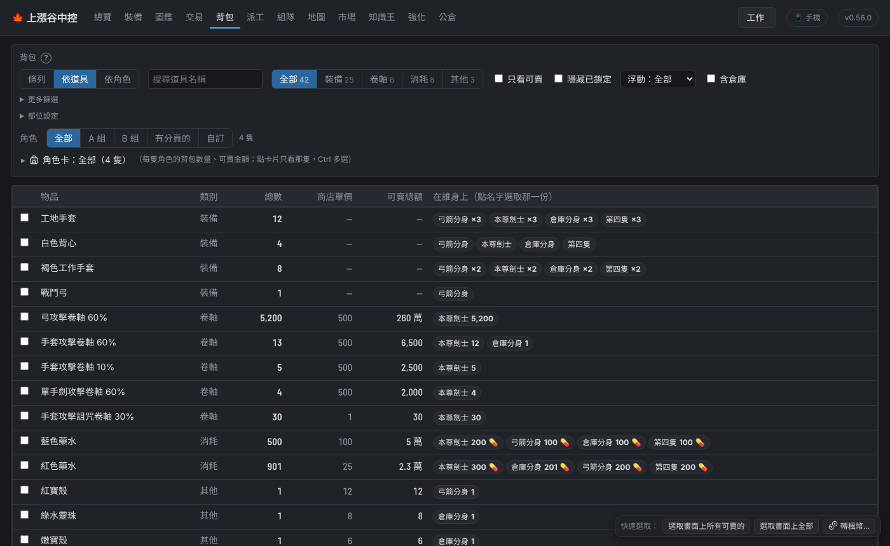

- 一次看全部角色的背包（可含倉庫）。三種看法：**條列**（每件一列，看浮動和判斷）、**依道具**（每樣東西在誰身上）、**依角色**（像遊戲背包的格子）。
- 上方角色卡點一下只看那隻（Ctrl 多選）；類別、只看可賣、隱藏已鎖定可以篩選。
- 勾選後底部出現動作列：**賣出／鎖定／解鎖／給…／轉楓幣…**，會依角色建立工作，到「工作」確認。

### 派工
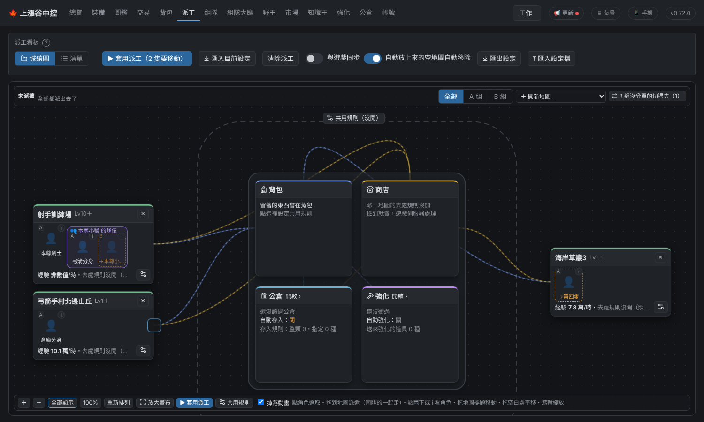

- **城鎮圖**：中間是城鎮（背包、商店、公倉、強化），外面是地圖；A、B 組的角色放在同一張圖上（頭像標 A／B）。遊戲裡同隊的角色有隊伍框，拖隊伍框整隊一起走，沒組隊的單隻走。
- 上方「＋ 開新地圖」放上地圖，把「未派遣」的角色**拖進地圖**；點一下可以多選一起拖。**點兩下角色**（或按頭像的 i）打開角色抽屜：「裝備」頁看每件的 +幾、剩幾格、卷軸加成、浮動，點一件跟身上的比較後「確認穿上」。「能力點」「技能」頁先在草稿上加減，按「確認分配」才送出（加了退不回來）；也能設自動配點／自動配技能計畫、Buff 自動施放、掛機用哪一招。「掛機設定」頁是自動喝水、到圖自動掛機等開關。
- **去處規則**：每樣掉落物要去背包（留著）、商店（撿到就賣）、公倉、還是強化。按「共用規則」設定全部地圖的規則，並打開「派工地圖套用」；某張圖要例外，按地圖右下角的設定鈕個別改。
- 排好按 **▶ 套用派工**：角色換圖、開始掛機，並把那張圖算好的自動販售設到遊戲。
- **照表操課**（共用規則裡打開）：規則設定一次，中控每分鐘自動把角色所在地圖的自動販售對齊規則，不用再按套用，新角色也一樣；在遊戲裡手動改的會被改回來。
- 自己加的地圖會一直留著；「與遊戲同步」自動放上來的地圖沒人時會自動移除（按「📌」就不會）。
- **⤓ 匯出設定／⤒ 匯入設定檔**：地圖和去處規則存成檔案，備份或給別人用。

### 組隊
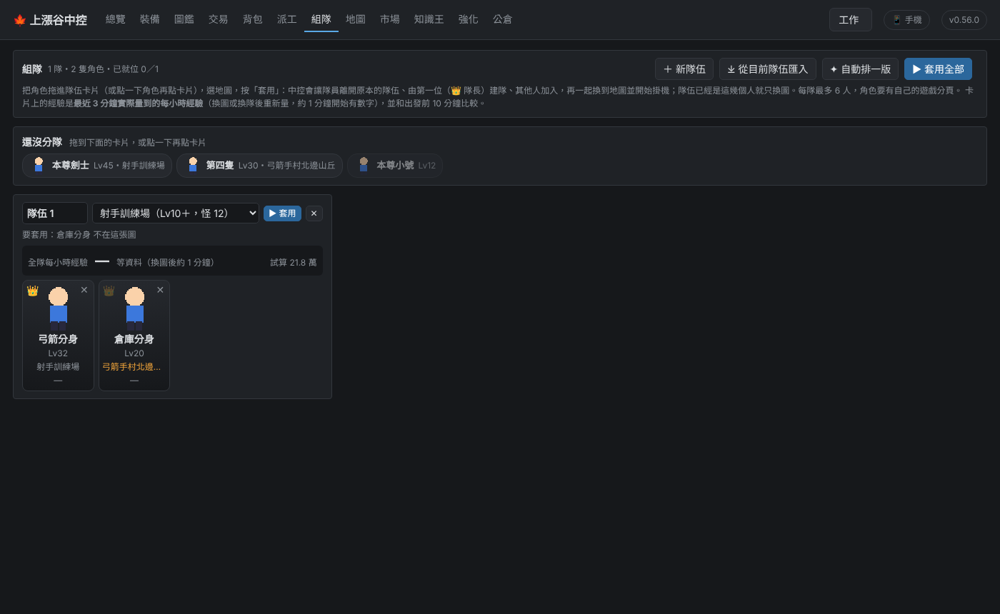

1. 按「＋ 新隊伍」，把角色拖進隊伍卡片（或點角色再點卡片）。第一位 👑 是隊長。
2. 每張卡片選要去的地圖。
3. 按「**▶ 套用**」或「套用全部」：中控會自動離開舊隊伍、隊長建隊、其他人加入，再一起換圖並開始掛機（也會套用派工看板上那張圖的自動販售）。

- 「⤓ 從目前隊伍匯入」照遊戲裡現在的隊伍建卡片；「✦ 自動排一版」依估算幫你分組。
- 卡片上的「全隊每小時經驗」是中控即時量的最近 3 分鐘，換圖後約 1 分鐘開始有數字，並和出發前比較。

### 野王
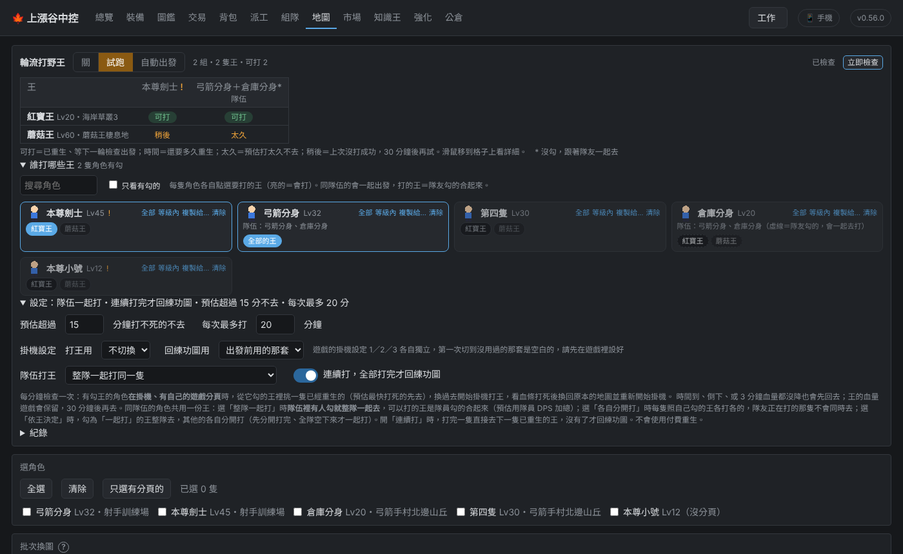

**輪流打野王**（上方分頁「野王」）
1. **選誰打哪隻王**：預設「依王看」，每隻王一張卡片。按「＋ 加角色」把角色加進來（或「加入等級夠的」）；點卡片上的角色＝不讓它打這隻。也可以切到「依角色看」，在每隻角色的卡片上點王的名字。
2. **掉落篩選**（可略過）：按右上「💰 掉落篩選」，打開「到野王地圖時自動套用販售」。共用規則選小怪掉的裝備／卷軸／技能書／雜物要賣還是留，👑 王會掉的預設一律保留；某隻王要例外就按「調整」。
3. 模式先選「**試跑**」→ 按「立即檢查」，在「紀錄」確認會去打哪隻；沒問題再改「**自動出發**」。

- **依隊伍看**：一個隊伍一張卡片，選這隊「一起打同一隻／各自分開打／依王決定」；卡片會寫還在等哪個隊員（例如沒有遊戲分頁、沒在掛機）。點王的名字可以設定這隊不打（🚫）。一起打要全員能出發才去，倒下原地復活，有人回去整隊一起回。
- **⚙ 設定**：隊伍打王（整隊一起打／各自分開打／依王決定）、連續打、預估超過幾分鐘打不死的不去（想打血多的王要調大）、血量幾分鐘沒降就先離開、掛機設定組合（遊戲的 1／2／3）。
- 王的血量有在掉就打到死，不會打到一半被拉去別的王。
- **強制停止**：打王中想讓角色回去練功，在上方「正在打」按那隻角色的「⏹ 停止」，或「⏹ 全部停止」；30 分鐘內不會再被派去打王，按摘要旁的「恢復」可以解除。
- 出發條件：角色**在掛機、有自己的遊戲分頁（或背景執行）**、沒有其他工作。
- 卡片狀態：已重生／多久後重生／打王中（上方另有即時血條和預估時間）；角色旁邊的小字是它自己的狀態（可打、還要多久、太久、稍後）。

**地圖查詢、掉落物查詢**在「圖鑑」分頁上方切換。

### 市場
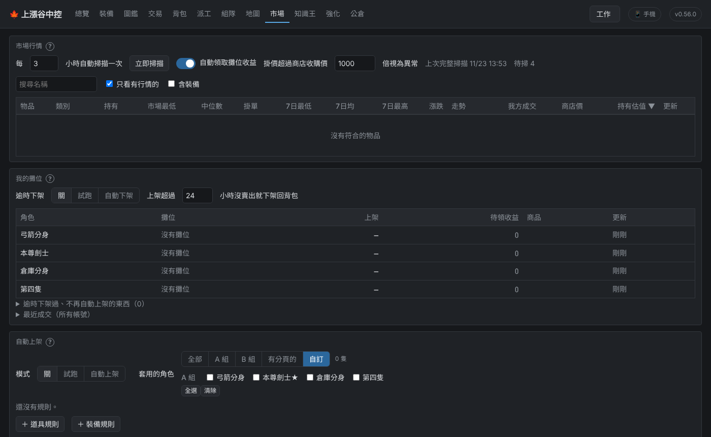

- **行情**：中控定時查你背包裡有的道具在自由市場的最低價、中位數、7 日走勢與持有估值（從開始使用那天起累積）。
- **我的攤位**：各帳號攤位、待領收益、最近成交；可以「自動領取攤位收益」、設定「逾時下架」（上架太久沒賣掉自動下架）。
- **自動上架**：用規則挑要賣的東西，定價基準（市場最低價、中位數、7 日平均或固定價）加減百分比，**每條規則都要設底價**。先用「試跑」確認。

### 知識王
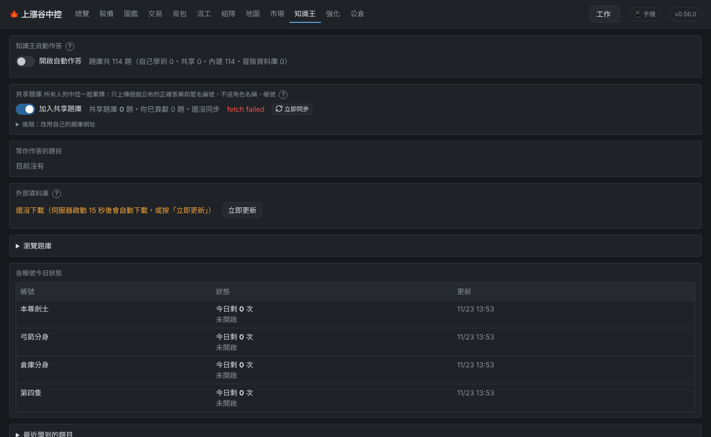

- 打開「自動作答」後，中控用內建題庫＋冒險資料庫＋**共享題庫**自動回答。
- 題庫沒有的題目會停下來，在面板上作答；答過的記進題庫。
- 共享題庫只上傳遊戲公布的正解，不送角色名稱或帳號；可以關掉。

### 強化
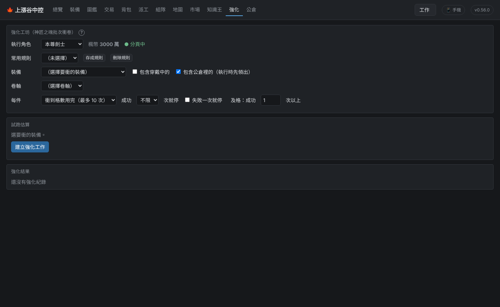

1. 選**執行角色**（裝備和卷軸要在這隻身上，可勾選從公倉領）、**裝備**、**卷軸**（只列出適用的）。
2. 設定每件衝幾次、成功幾次停、失敗就停、成功幾次算及格。
3. 按「試跑估算」看要用幾張卷軸、多少楓幣、預估幾件及格。
4. 「建立強化工作」→ 到「工作」**確認**才會開始。**衝卷無法復原**，詛咒卷軸可能讓裝備消失。

- 結果下面可以「分流」：及格的鎖定或交給別的角色，不及格的賣掉或存公倉。
- **自動強化**：設好上面的選項後按「＋ 把上面的設定加成自動規則」，選「每次確認」（建工作等你確認）或「每日上限內自動」（填每天最多花幾萬，上限內直接衝；詛咒卷軸一律等確認）。只衝還沒衝過的裝備。

### 公倉
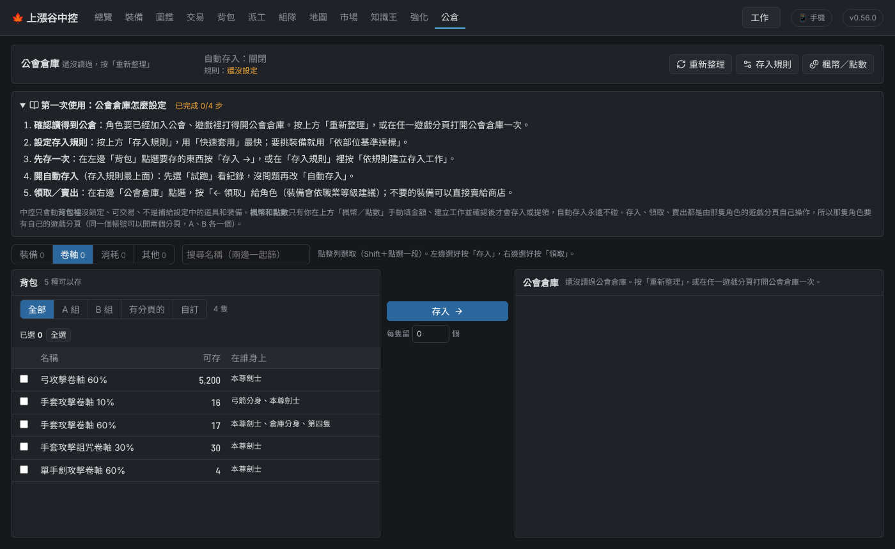

- 第一次使用照上方的「第一次使用」步驟做（約 5 步）。
- **左邊背包、右邊公倉**並排：左邊勾要存的按「**存入 →**」；右邊勾要領的、選「領給誰」按「**← 領取**」。
- **存入規則**：要存哪些（整類或個別）、裝備的浮動條件、每種保留幾個；可以手動存一次，或開「自動存入」（先試跑）。
- 公倉內容按「**重新整理**」更新（在遊戲裡直接存取的東西，要按一下才會看到）。
- **楓幣、點數**一律要你自己填金額、確認後才會存入或提領，自動存入不會碰。

### 手機版
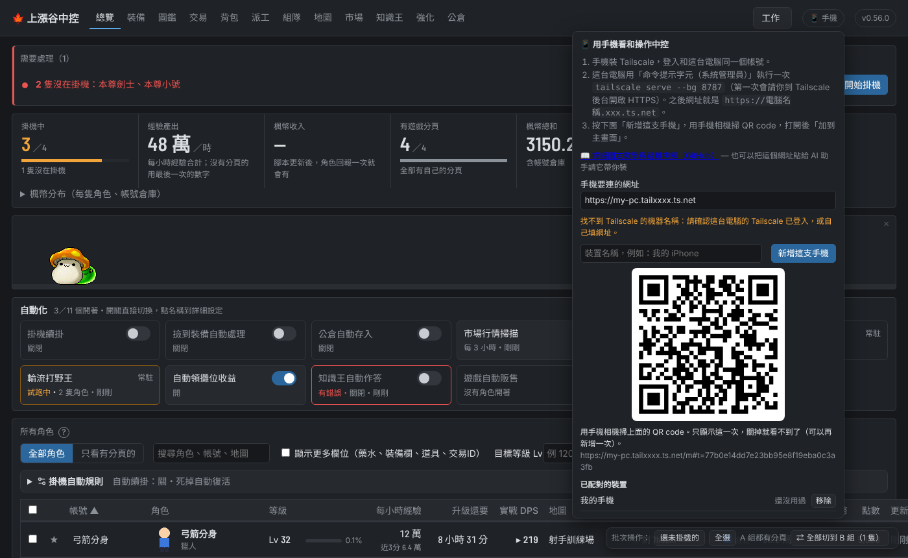

手機透過 Tailscale 連回家裡的電腦，可以看角色狀態、開始／暫停掛機、換圖、確認或全部重試工作、切換打王、套用組隊，也會顯示預計升級時間。

<p>
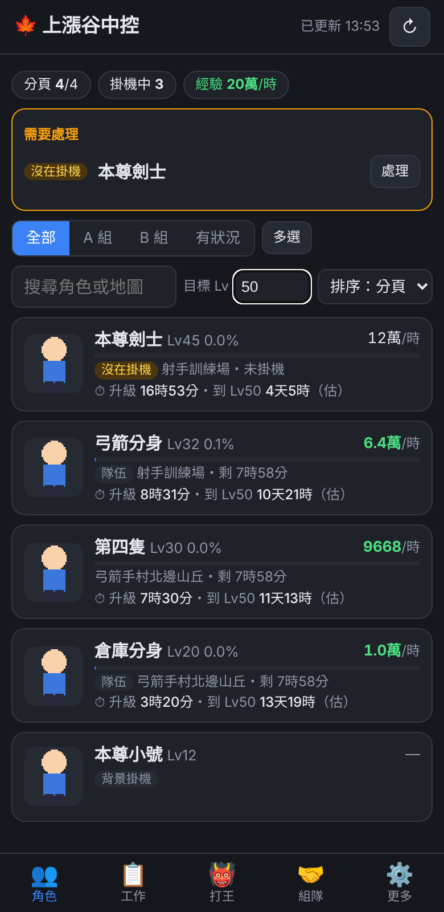
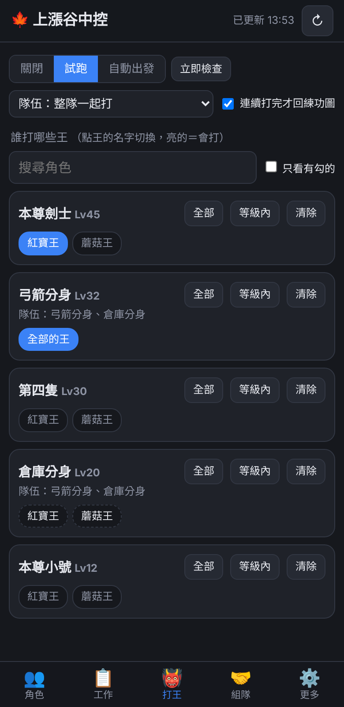
</p>

安裝步驟見 **[手機版安裝教學](mobile.md)**（Tailscale、HTTPS、掃 QR code、加到主畫面）。

### 背景執行（試用）
不想一直開著好幾個 Chrome 視窗的話：到「帳號」分頁（或按右上角「🖥 背景」）新增帳號（帳號多可以用 CSV 匯入）→ 按「🔑 批次登入」，在跳出來的 Chrome 視窗用 Google 登入遊戲，看到遊戲畫面後關掉那個視窗就換下一個。之後中控會在背景開 Chrome 跑遊戲（看不到視窗），勾選要開哪幾隻角色就好；點角色名字可以叫出那隻的遊戲視窗。你平常的 Chrome 也開著同一隻時，背景那頁會自動暫停。需要 Node.js 22 以上。詳見 [README 的背景執行](../README.md#背景執行v057-起試用)。

---

## 自動更新

- **中控**：每 2 分鐘到 GitHub 檢查一次，有新版而且沒有工作在執行，就自動更新並重啟（約 5 秒）。不想自動更新：面板右上角版本 → 取消「自動更新」，改成手動按「立即更新並重啟」。舊版會備份在 `backup/`。
- **遊戲腳本**：功能程式由中控提供，中控更新後遊戲頁面會在閒置時自動重新整理載入新版（前提是 3-5 設了「總是」）。
- `start.bat` 本身不會自動更新。

---

## 常見問題

| 狀況 | 處理 |
|---|---|
| 黑色視窗說找不到 Node.js | 裝完 Node.js 後重新開機再執行 `start.bat` |
| 黑色視窗一閃就關掉 | 在資料夾空白處按 Shift＋右鍵 →「在此處開啟 PowerShell／命令視窗」，輸入 `.\start.bat`，看錯誤訊息截圖 |
| 遊戲右下角「連不到中控伺服器」 | 確認黑色視窗開著 |
| 遊戲右下角完全沒有提示 | 第 3-3 步的「允許使用者指令碼」沒開，或腳本沒啟用（Tampermonkey 控制台看開關） |
| 打開 `szg-hub.user.js` 只看到一堆文字、沒有安裝畫面 | 這個設定檔還沒裝竄改猴，或竄改猴被停用 |
| 面板看不到某隻角色 | 那個設定檔的遊戲分頁要開著；同帳號第二隻要開它自己的分頁或切換過去一次 |
| 面板顯示有分頁不是最新腳本 | 那個遊戲分頁按 F5；還是舊的就檢查 3-5 的「總是」 |
| 遊戲顯示「遊戲已更新，請重新整理」 | 遊戲本身改版，重新整理遊戲分頁 |
| 8787 埠被占用 | 用記事本打開 `start.bat`，把 `PORT=8787` 改成別的數字；`szg-hub.user.js` 裡的網址也要一起改 |
| 想清空所有資料 | 關掉黑色視窗，刪除 `data` 資料夾再重新啟動 |

更多問題見 [README 的常見問題](../README.md#四常見問題)。

---

## 給 AI 助手的說明

> 如果你是協助使用者安裝或使用的 AI 助手，以下是這個專案的事實，請依此引導，不要另外發明做法。

- 專案：上漲谷中控（GitHub `Arashi9910/szg-hub-public`），給同時玩多個帳號的人用的本機中控面板。遊戲網址 `https://play.szg08.com/game/`。
- 組成：Node.js 本機伺服器 `server.js`（**只聽 `127.0.0.1:8787`**，不要改成對外開放、不要開路由器連接埠）＋面板 `dashboard.html`（`http://127.0.0.1:8787`）＋每個 Chrome 設定檔裡的 Tampermonkey 載入器 `szg-hub.user.js`（從 `http://127.0.0.1:8787/szg-hub.user.js` 安裝，執行時由伺服器提供 `agent.js`）。
- 背景執行（v0.57 起，`bg.js`）：面板「🖥 背景」讓中控用使用者電腦上的 Google Chrome（`--headless=new`，每個帳號獨立的 `data/bg/<編號>` 資料夾）跑遊戲分頁並注入中控腳本，不需要 Tampermonkey；登入是開一般的 Chrome 視窗讓使用者自己用 Google 登入後關掉。需要 Node.js 22 以上（內建 WebSocket）。
- 啟動：Windows 雙擊 `start.bat`（找 Node.js → 先跑 `update.js` 自動更新 → 跑 `server.js`；結束碼 3 表示更新後重啟）。需要 Node.js LTS。
- Tampermonkey 必要設定：Chrome 138 以上在 `chrome://extensions` → Tampermonkey「詳細資料」開啟「允許使用者指令碼」；更舊的 Chrome 開「開發人員模式」（參考 <https://www.tampermonkey.net/faq.php?q=Q209>）。另外 Tampermonkey 設定改「進階」模式，「外部 → 更新間隔」設「總是」。
- 驗證順序：① 黑色視窗顯示「上漲谷中控已啟動」→ ② 瀏覽器打開 `http://127.0.0.1:8787` 看得到面板 → ③ 遊戲分頁右下角顯示「中控：已連線」→ ④ 面板上出現角色。
- 不需要也不應該輸入遊戲帳號密碼到中控。會動到遊戲資料的操作都要在面板的「工作」按確認。
- 手機版另見 `docs/mobile.md`（只能用 `tailscale serve`，不要用 `tailscale funnel`）。
- 資料在中控資料夾的 `data/`；刪除即重置。功能細節見 `README.md`。
